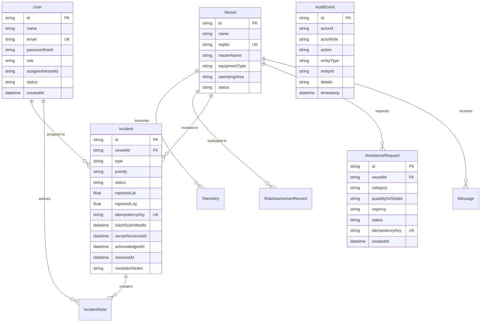

# Ocean Pulse — Database Schema Documentation

The Ocean Pulse persistent layer is managed via **Prisma ORM**, configured for zero-dependency local execution via SQLite (`dev.db`), and scalable to PostgreSQL in production (e.g. Render PostgreSQL via `schema.postgresql.prisma`).

---

## 1. Entity-Relationship Model

---

## 2. Table Specifications

### `User`
Stores authenticated shore safety operators, supervisors, vessel masters, administrators, and demo viewers.
- `id` (UUID, Primary Key)
- `email` (Unique, indexed)
- `passwordHash` (Bcrypt salted hash)
- `role` (`ADMIN`, `SHORE_OPERATOR`, `SUPERVISOR`, `FISHERMAN`, `DEMO_VIEWER`)
- `assignedVesselId` (Nullable foreign key binding fisherman user accounts to their vessel)

### `Vessel`
Fleet catalog of monitored fishing units.
- `id` (e.g., `B01`, `B02`, Primary Key)
- `regNo` (Unique official maritime registration)
- `equipmentType` (`basic`, `standard`, `advanced`)

### `Incident`
Persistent emergency distress events and hazard responses.
- `id` (UUID, Primary Key)
- `idempotencyKey` (Unique string generated by client to prevent duplicate SOS creation)
- `status` (`RECEIVED`, `ACKNOWLEDGED`, `ASSESSED`, `ASSIGNED`, `ACTION_IN_PROGRESS`, `RESOLVED`, `CLOSED`)
- `priority` (`CRITICAL`, `HIGH`, `MEDIUM`, `LOW`)
- Separate timestamps: `clientSubmittedAt`, `serverReceivedAt`, `acknowledgedAt`, `escalatedAt`, `resolvedAt`.

### `AssistanceRequest`
Non-distress logistical demands (water, rations, diesel fuel, mechanical tow).
- `category` (`DRINKING_WATER`, `FOOD`, `MEDICAL`, `FUEL`, `MECHANICAL`, `COMMUNICATION`, `WEATHER_INFO`, `EMERGENCY_RESCUE`, `OTHER`)
- `status` (`PENDING`, `ACKNOWLEDGED`, `DISPATCHED`, `COMPLETED`, `CANCELLED`)

### `AuditEvent`
Monotonic immutable audit trail recording every state change, escalation, and operator decision for maritime accountability.
